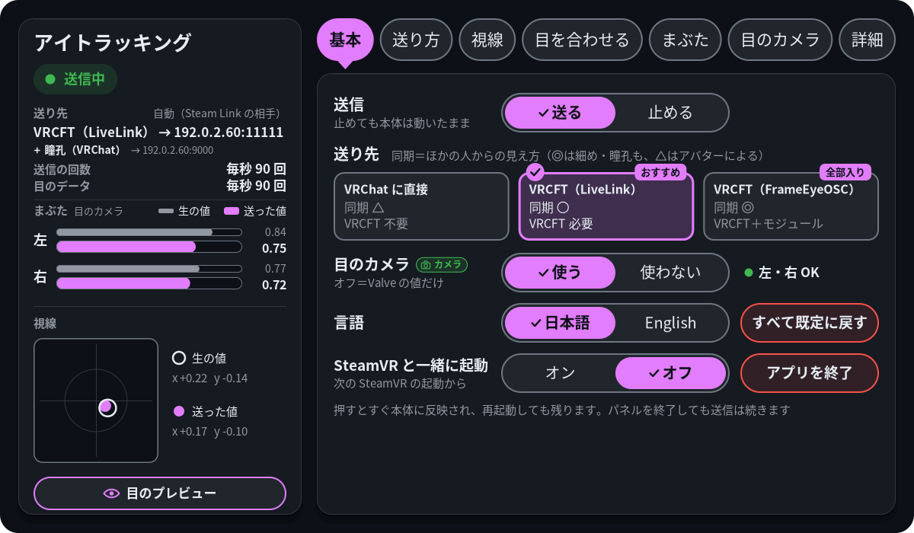
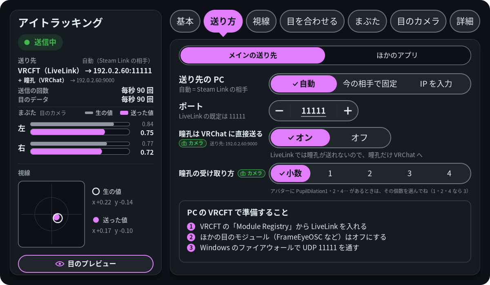
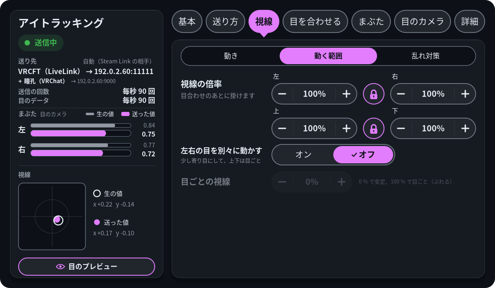
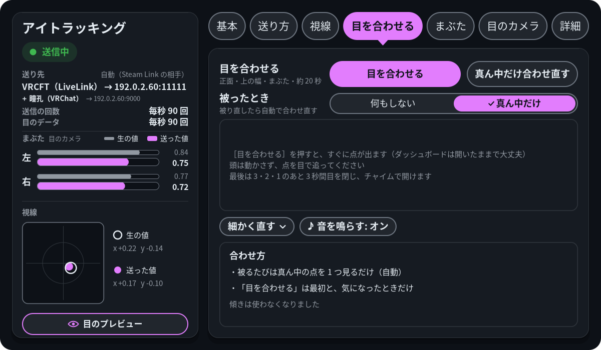
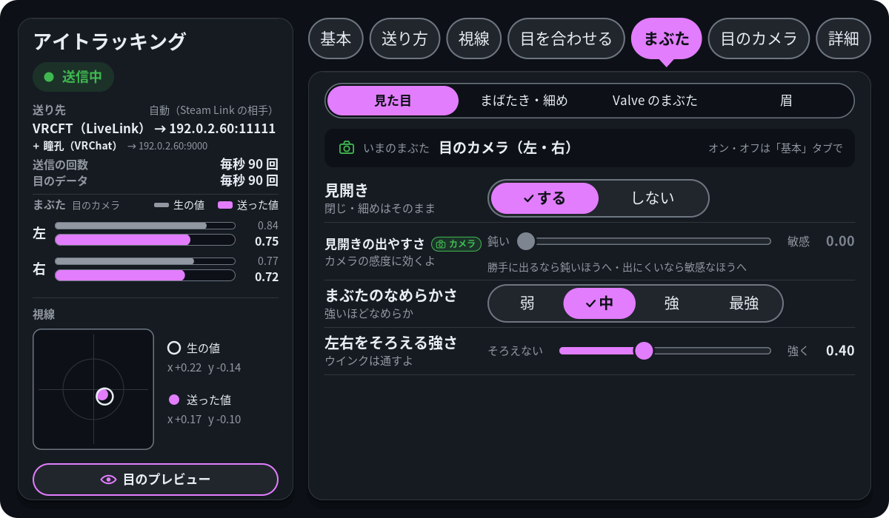
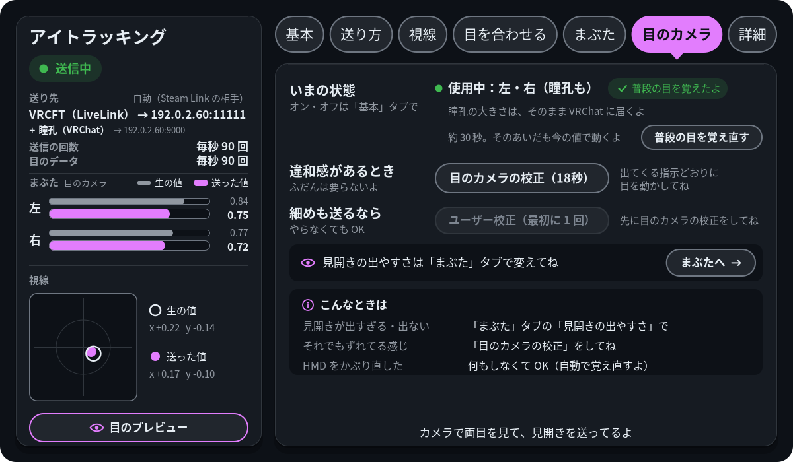
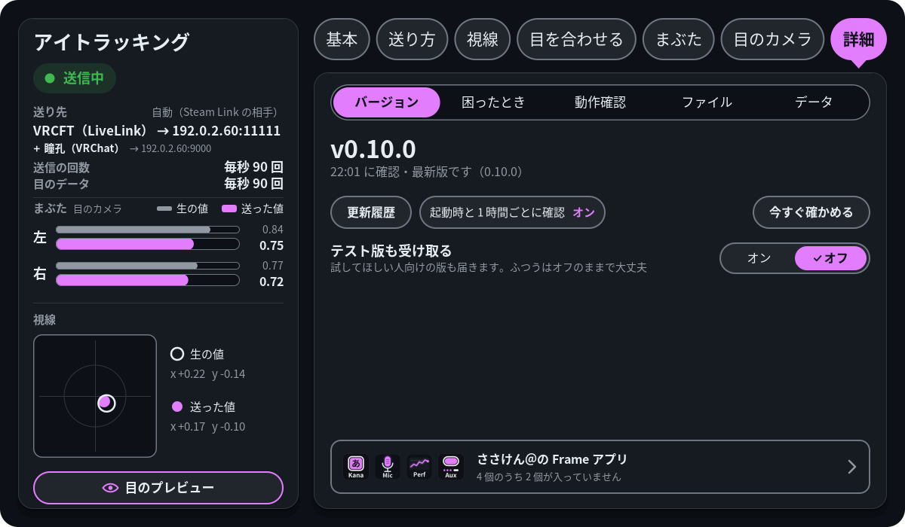
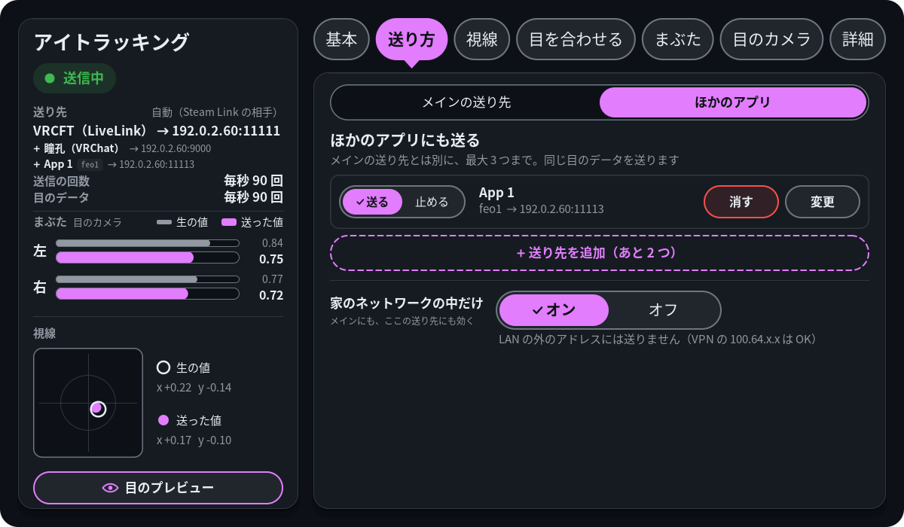

# パネル

[README に戻る](../README.ja.md)

`./install.sh --with-panel` で、SteamVR のダッシュボードに「Eye」のパネルが入ります。次に SteamVR を起動したときから一緒に起動します。すぐ開きたいときは、ダッシュボードの「プログラムを起動」（＋）から「frameeyeosc パネル」を選んでください。

| 基本 | 送り方 |
|---|---|
|  |  |
| **視線** | **目を合わせる** |
|  |  |
| **まぶた** | **目のカメラ** |
|  |  |
| **詳細** | **送り方（ほかのアプリ）** |
|  |  |

- 左の列には、いつでも今の状態が出ます: 送信中か止めているか、送り先、毎秒の送信回数、目のデータが毎秒何回来ているか（60 未満は赤で「少なめ」。その下に、遅いのが本体か Frame か）、左右のまぶたと視線（生の値と送った値）、設定のエラー。「Track Dominant Eye Only」の設定がオンのあいだは、視線の見出しの行に、Frame がどちらの目で追っているかが出ます（「Frame の設定: 右目だけで追っています」）
- 目のプレビュー: 左の列のいちばん下のボタンで、タブの上にシートを開き、両目の動きをそのまま描きます: まぶた（0.75 がふだんの開き。見開くとまぶたが上がる）、細め（下まぶたが上がる）、瞳孔の大きさ、目の向き。描く値は「送る値」「生の値」（Valve の開き具合と、なめらかにする前の視線）「カメラの値」（目のカメラが読んだ値）から選べます。目の下に、まぶたの値・どこから来たか（「Valve」か「カメラ」）・瞳孔の mm。「鏡で見る」（最初はオン）は鏡に映した向きで、右目が右に出ます（オフでほかの人や正面のアバターから見た向きになり、右目が左に出ます）。「止める」で描くのを止めます。目のカメラを使っているときは「カメラ映像」（うっかり映らないよう最初はオフ。一度オンにすると、パネルを起動し直すか、オフにするか、カメラが止まるまで、開くたびにオンのまま）で、目ごとの今のカメラの映像と、eyecam が見つけた瞳（緑の丸）・瞳を探す範囲（黄色の枠）・上と下のまぶた（瞳の上と下に水色とピンクの点。そのフレームで見つからなければ出ません。「生の値」では読んだまま、ほかではちらつかないようなめらかにします）・そのフレームでカメラが読んだまぶたの値・「閉じてる判定」も出します。2 つの映像のあいだのスイッチ（「まぶた」「瞳」「探す範囲」。最初は全部オン）で、それぞれの印を出したり消したりできます。映像は表示するだけで保存しません（[プライバシー](privacy.ja.md#プライバシー)）。アバターの目の形は人によって違うので、動きの確認用です。タブ・✕・ダッシュボードを閉じると閉じます
- 基本: 送信の一時停止、送り先（3 枚のカード: VRChat に直接・VRCFT（LiveLink、おすすめ）・VRCFT（FrameEyeOSC、全部入り）。それぞれほかの人からの見え方（FrameEyeOSC は細めと瞳孔も届くので ◎）と、PC に何が要るかを表示。「VRChat に直接」のときは、カードの下に「目が動かないアバターは、VRCFT（LiveLink か FrameEyeOSC）にすると動きます」と灰色で 1 行）、目のカメラ（準備前は「使っていない」と目のカメラタブへの［はじめる →］、準備後は「使う / 使わない」（`camera_lids`）と「左・右 OK」などの短い状態）、言語（日本語 / English。右に［すべて既定に戻す］）、SteamVR と一緒に起動（右に［アプリを終了］）
- 送り方: いちばん上の切り替えで「メインの送り先」と「ほかのアプリ」の 2 ページ（最後に開いたページを覚えます）。「メインの送り先」: 送り先の PC（自動、今送っている PC で固定、または入力。下を参照）とポート（− / ＋、数字を押すとテンキーで 1〜65535 を入力）。VRChat に直接のときはパラメーター名の頭、EyeTrackingActive の型、Steam Link の名前も送るか、VRChat 標準の目も動かすか、LiveLink・FrameEyeOSC のときは PC の VRCFaceTracking で準備すること（FrameEyeOSC は 4 ステップで、モジュールの入手先のアドレス付き。押すと Frame のブラウザーでそのページを開きます）。LiveLink で目のカメラを使っているときは「瞳孔は VRChat に直接送る」（`pupils_to_vrchat`）も。目のカメラを使っていて VRChat に直接か LiveLink のときは「瞳孔の受け取り方」（`pupil_bits`）も。こういう目のカメラがないと使えない行には緑の「カメラ」バッジが付き、カメラを使っていないとき（準備前か「使わない」）は、代わりに点線の 1 行（押すと目のカメラタブ）が出ます。「ほかのアプリ」: メインとは別に同じ目のデータを送る先を 3 つまで（`extra_outputs`）。1 行ごとに「送る / 止める」、名前、書式（`feo1` = FrameEyeOSC と同じ形、`osc`）、宛先、VPN / PUBLIC の印、送れていないときは赤で理由、［消す］と［変更］。［消す］を押すと、その行が「「App 1」を消す？もう送らなくなるよ」と［やめる］・赤い［消す］に変わります（パネルの中で確かめます。確かめている行は 1 つだけで、ほかのボタンやタブを押すとやめになります）。［＋ 送り先を追加］で 書式 → 宛先（メインと同じ PC、Steam Link の PC、この Frame、IP を入力）→ ポート（同じテンキーでも入力）の 3 ステップ。変更からは消すこともできます（パネルの中で確かめてから）。名前は自動で「App 1」…（`config.json` で変えられます）。その下に「家のネットワークの中だけ」（`lan_only`、最初はオン。メインにも効きます。オフにすると LAN の外にも送り、その送り先に PUBLIC が付きます）。送っている先は、左の列のメインの送り先の下に 1 行ずつ出ます（断られている先は赤で理由）
- 視線: いちばん上の切り替えで 3 ページ（初めては「動き」、あとは最後に開いたページ。パネルを起動し直しても開きます）。「動き」: スムージングのオン / オフ、なめらかさの弱 / 中 / 強と 3 つの値、見つめている時の遊び。「動く範囲」: 視線の倍率（目が左・右・上・下へどこまで動くか。5〜200 %。目合わせのあとに掛け、目合わせでは変わりません。左右・上下のあいだの鍵を閉じているあいだは、両方いっしょに変わります）、左右の目を別々に動かす。「乱れ対策」: まばたき中は視線を止める、不確かな視線を使わない、一瞬の途切れを消す
- 目を合わせる: ボタン 1 つで正面・上の幅・まぶたを約 20 秒で合わせる（[目を合わせる](eye-fit.ja.md#目を合わせる) を参照）、［真ん中だけ合わせ直す］（真ん中の点 1 つ）、被ったときに自動で合わせ直すもの（「被ったとき」: 何もしない・真ん中だけ）、結果と［元に戻す］、「細かく直す」の中で値を手で直す（閉じているあいだは、合わせ方の箱が出ます）
- まぶた: いちばん上の切り替えで 4 ページ（初めては「見た目」、あとは最後に開いたページ。パネルを起動し直しても開きます）。「見た目」: いまのまぶたがどこから来ているか（目のカメラ・片目だけ目のカメラ・Valve の値。カメラのオン / オフは「基本」タブで）、「見開き」（する / しない、`widen`。しないと、カメラがあってもなくても、まぶたはふつうに開いた所より上に行かない。閉じる・細めはそのまま。そのあいだ下のスライダーは灰色）、目のカメラを使っているときは「見開きの出やすさ」（鈍い〜敏感のスライダー 1 本。カメラの目にはその感度、Valve の値の目には目を合わせた目の 4 段階（しない / 控えめ / ふつう / 出やすい、`lid_widen`））、目のカメラを使っているときは「半目の読み直し（AI）」（する / しない。eyecam のまぶたの拒否権で、既定はしない。横を見たときなどに開いた目が半目に読まれたら、小さな AI が見直して開いた目に戻す。軽い細めも開いた目に戻ることがある。まだ試しの機能で、作った人の目だけで学習している）、まぶたのなめらかさ（弱 / 中 / 強 / 最強）、左右をそろえる強さ（`lid_sync`）。「まばたき・細め」: まばたきを届ける（閉じたまま保つ時間）、まばたきを両目でそろえる（`blink_sync_below`）、「送るまぶた」（目ごとにいま送っているまぶた。目のカメラのまぶたの目は緑。その上に「ほぼ開いてたら全開にする」の線、下にその 2 つの値: カメラのまぶたがない目の `lid_open_snap` と、ある目の `camera_lid_open_snap`）、目のカメラを使っているときは細めたときのまぶたの下限（`camera_lid_floor`。効くのはカメラの目があるとき）。「Valve のまぶた」: 自動キャリブレーションと覚えた値、左右の倍率、左右の今の開き具合の上に重ねた閉じと開きの 2 つの目盛り（目を閉じたり開いたりしながら合わせる）、なめらかさの 2 つの値。両目とも目のカメラのまぶたのときは、カメラが見失ったときの予備だと出します。「眉」: 「見開きで眉も上げる」（する / しない、`brow_from_widen`。初めはしない。カメラは眉を見ていないので、アバターの眉は見開きについていく。「見開き」が「しない」でも上がる）と、「する」のあいだだけ「眉の上がり方」（`brow_strength`、弱い〜強い）
- 目のカメラ: eyecam が動いているあいだ出ます。準備を始める前は「目のカメラでできること」と［はじめる（約 2 分）］、押すと準備のチェックリスト（[目のカメラ](eyecam.ja.md#目のカメラ)）。済んだあとは、いまの状態（オン / オフは「基本」タブで）とその下の［普段の目を覚え直す］（約 30 秒で普段の目を覚え直す。そのあいだも今までの値でまぶた・見開き・細めが動き、覚え終わったら新しい値に移る。校正の値はそのまま）、違和感があるときの「目のカメラの校正（18秒）」、目を細めた動きも送りたいときの「ユーザー校正（最初に 1 回）」、「映像のもらい方」（どこから映像をもらっているか、自動 / dsp / 道具の切り替え、Konsole で道具を入れる・消す。[目のカメラ](eyecam.ja.md#目のカメラ)）、こんなときはどうするか（入るぶんだけ）
- 詳細: いちばん上の切り替えで「バージョン」「困ったとき」「動作確認」「ファイル」「データ」の 5 ページ（初めては「バージョン」、そのあとは最後に開いたページ。パネルを起動し直しても）。「バージョン」: 版の表示と更新の確認・更新（自動の確認のオン / オフも）と「更新履歴」（版ごとの要約と変更点、新しい順。開くのは 1 つずつで、スティックか右の上下の山形のボタンでスクロール）。「困ったとき」: 困ったときにスクショを送る「診断」のページ（[うまく動かないとき](troubleshooting.ja.md#うまく動かないとき)を参照）、その設定がある SteamVR（SteamOS 0.5.7 のもの）なら「目のカメラの速さ」（「いつも毎秒 90」か「SteamVR に任せる」）、校正と目合わせの最近の記録（下を参照）。「動作確認」: 視線の点を表示と点の距離、目のログの記録（下を参照）、eyecam が動いているあいだは「開発用」の「目の撮影」（目の処理を調整するための目のカメラの録画で、目の映像が `~/eyecam/rec_…/` に残ります。1 回で約 2.5 GB。[panel/README.md](../panel/README.md) を参照）と、目のカメラの準備が済んだら「細めの学習用に撮る」（「半目の読み直し（AI）」をいろんな人の目で学習させるために、開発者へ送る目の録画。任意です。ボタン 1 つで約 1 分半〔閉じる・細める・見開く・上下左右を見る。1 本 約 2.7 GB〕。初めてのときだけ同意と、眼鏡・度付きインサートを使っているかを聞きます。送って消すまで `~/eyecam/contrib/` にたまり、送りやすいように 1 つのファイルにまとめられます）。「ファイル」: ファイルの場所、本体の PID、コマンドで固定中の項目。「データ」: この Frame に残している目のログ・目の撮影の映像・校正の目の画像（開発者モードのときだけ）が何件・何 GB あるかと、それぞれの［消す］（確認してから消します。元に戻せません。校正の結果は残るので、見開きの調整はそのまま）
- 記録: パネルから始めた目のカメラの校正と、目合わせ（被ったときに自分で始めた合わせ直しも）のたびに、`~/.local/state/frameeyeosc/reports/` に小さなフォルダを 1 つ残します（新しい 10 件だけ）: `summary.json`（何をして、どう終わり、なぜか。版、診断コード、条件: ダッシュボードを開いていたか、カメラと視線トラッカーの速さ、かぶってから何秒か）、`status.jsonl`（その間 1 秒ごとの本体と eyecam の状態）、`logs.txt`（始まる 15 秒前から終わりまでの、本体・パネル・eyecam のジャーナルと Valve のアイトラッカーのログを時刻順に。300 KB まで）、校正なら `calib_result.json`（その数値。目の画像は入れません）、`report.txt`。「困ったとき」に新しい 3 件（［すべての記録］で全部）、［見る］で理由・流れ・ファイルを開きます。目合わせや校正が失敗した画面にも「ログを記録したよ」と［記録を見る］が出ます。SSH からは `.local/bin/frameeyeosc-panel --report latest` でいちばん新しい記録の `report.txt` が出ます（`--report list` で一覧、`--report <フォルダ名>` でその記録。SteamVR が無くても動きます）。どこにも送りません

パネルは `config.json` を書き、状態ファイルを読みます。既定の言語を決めるために、起動時に 1 回だけ Steam の `~/.steam/registry.vdf` の `language` の行も読みます（読むだけ）。更新には `~/.local/share/frameeyeosc/frame-update.sh` を使います（上を参照）。閉じても、終了しても、入れていなくても frameeyeosc は送り続けます。ダッシュボードで開いていない間は何も描きません。そのとき読むのは、更新の確認を動かすほかは、更新の状態ファイル（`~/.cache/frameeyeosc/update-state.json`）を 1 秒に 2 回ほどだけです。ただし目を合わせている間は、終わるまで状態ファイルも読み、点を出します（ダッシュボードが開いていても閉じていても）。デバッグ用の視線の点をオンにしている間も、そのソケットで受け取り、サンプルが届いている間は 1 秒に約 90 回点を動かします。このときは状態ファイルも読み、`config.json` が変わったかを 1 秒に 10 回確かめます。「被ったとき」が「何もしない」以外で視線を合わせてあるときも、ヘッドセットを被ったのに気づくため、ダッシュボードを閉じている間 0.5 秒ごとに状態ファイルを読みます。目のプレビューを開いている間は、視線の点のソケットで受け取り（点は出しません）、1 秒に約 30 回描き直します。カメラ映像がオンなら、eyecam に 1 秒ごとに映像を頼み、それを読みます。「SteamVR と一緒に起動」は、パネルの systemd ユーザーサービス（`frameeyeosc-panel.service`）を有効 / 無効にします。ビルド方法や確認用のオプションは [panel/README.md](../panel/README.md) にあります。

## 送り先の PC を手で決める

「自動」は Steam Link の接続先の PC に送ります。違う PC に送っているときは、送り方タブの「送り先の PC」で［IP を入力］を押してください。テンキーが開くので、PC の IPv4 アドレス（例: `192.168.1.20`）を打って［決定］を押します。ポートは付けず、「ポート」の行で設定します。パネルが `config.json` の `host` に書き、行には「手動 192.168.1.20」と出ます。［自動］で元に戻ります。アドレスではなくホスト名にしたいときは、`config.json` の `host` を手で書いてください。行には「手動」と名前が出て、［自動］で戻せるのは同じです。

## ほかのアプリから目合わせを始める

Frame のほかのアプリ（コントローラーのボタンなど）から、コマンドでパネルの目合わせのボタンと［普段の目を覚え直す］を押せます。パネルが動いている必要があります（コマンドがパネルを起動することはありません）:

```sh
~/.local/bin/frameeyeosc-panel --action recenter   # ［真ん中だけ合わせ直す］（真ん中の点、約 2.5 秒）
~/.local/bin/frameeyeosc-panel --action fit        # ［目を合わせる］／［もう一度合わせる］（約 20 秒）
~/.local/bin/frameeyeosc-panel --action stop       # 動いている目合わせ・合わせ直しの［やめる］
~/.local/bin/frameeyeosc-panel --action relearn    # 「目のカメラ」タブの［普段の目を覚え直す］（約 30 秒）
~/.local/bin/frameeyeosc-panel --action open       # パネルを開く（2 回目に起動したときと同じ）
```

どれもボタンを押したのと同じで（ボタンが押せるときだけ）、ダッシュボードを閉じたままでも動きます: 被ったときの自動の合わせ直しと同じように点が出て、ダッシュボードは閉じたまま（そのあと開くと、いつもどおり止まります）。ダッシュボードが開いていれば、パネルを［やめる］のある「目を合わせる」タブにします。コマンドは標準エラーに短い 1 行（例 `recenter: started`、`fit: busy (a fit is running; use --action stop)`）を出し、次のコードで終わります:

| コード | 意味 |
|---|---|
| 0 | できた: 合わせ直し・目合わせ・覚え直しが始まった、`stop` で止めた、`open` でパネルを出した |
| 1 | 知らない動作・知らないオプション・引数の間違い（`frameeyeosc-panel` の使い方の間違いはどれも 1。知らない動作はパネルにつながずに断る） |
| 2 | パネルが動いていない（または 0.7.9 以前の、このコマンドが無いパネル） |
| 3 | パネルから 2 秒以内に返事が無い |
| 4 | 本体が動いていない |
| 5 | まだ一度も視線を合わせていないのに `recenter`: 先に `fit` |
| 6 | 使用中: 目合わせが動いている（先に `stop`） |
| 7 | 動いているものが無いのに `stop` |
| 8 | 目合わせの値が本体のコマンドで固定中（ボタンもグレー） |
| 9 | 本体は動いているが目のデータが来ていない（たいていはヘッドセットをかぶっていない） |
| 10 | 使用中: 合わせ直しが動いている（かぶったときの自動のものも。先に `stop`） |
| 11 | `relearn`: 目のカメラを使っていない・準備ができていない（オフ、準備前、eyecam が動いていない・ほかのことをしている、目の映像が来ていない）か、eyecam が断った。目のカメラの校正中の `recenter`・`fit`・`relearn` も（1 行に `calibrating` と出る。その間は目合わせのボタンもグレー） |

パネルは 4 分の 1 秒ほどで答えます（ダッシュボードを閉じているときのループの 1 回分）。`relearn` は eyecam の返事も待つので、長くてもあと 1 秒。動いているパネルとは、自分だけが使えるソケット（`$XDG_RUNTIME_DIR/frameeyeosc-panel.sock`。詳しくは [panel/README.md](../panel/README.md#ほかのアプリから動かす--action)）でやりとりします。待っている間、パネルはそのソケットを見るだけで、要求が来たときに状態ファイルと `config.json` を 1 回読みます。入っているパネルの版は `--version` でわかります。
