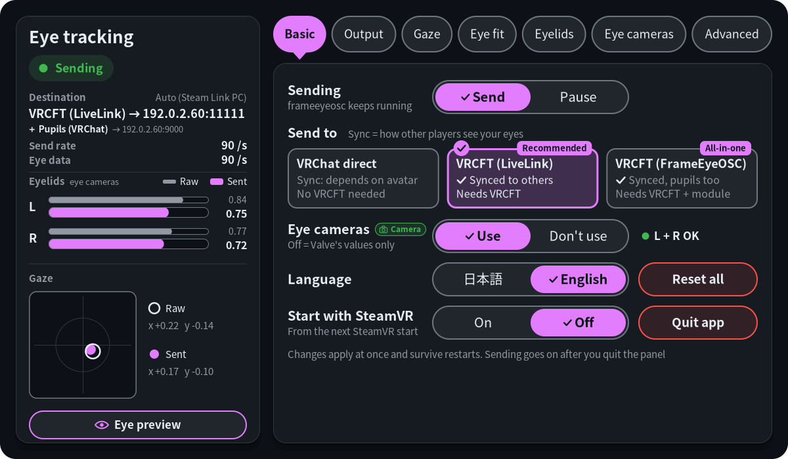
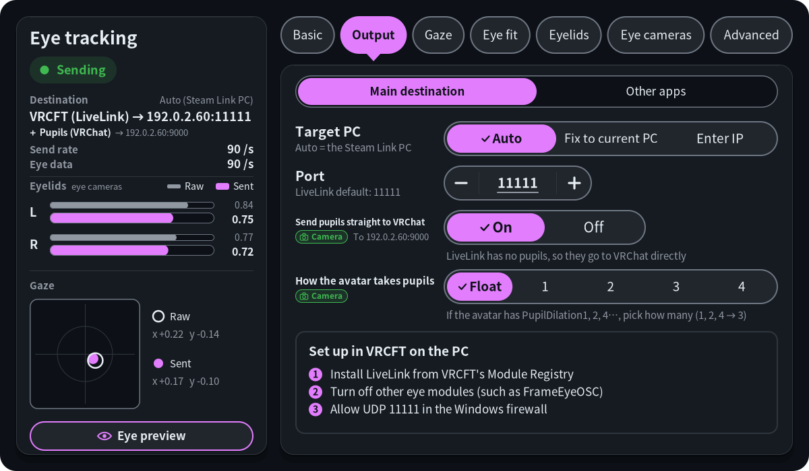
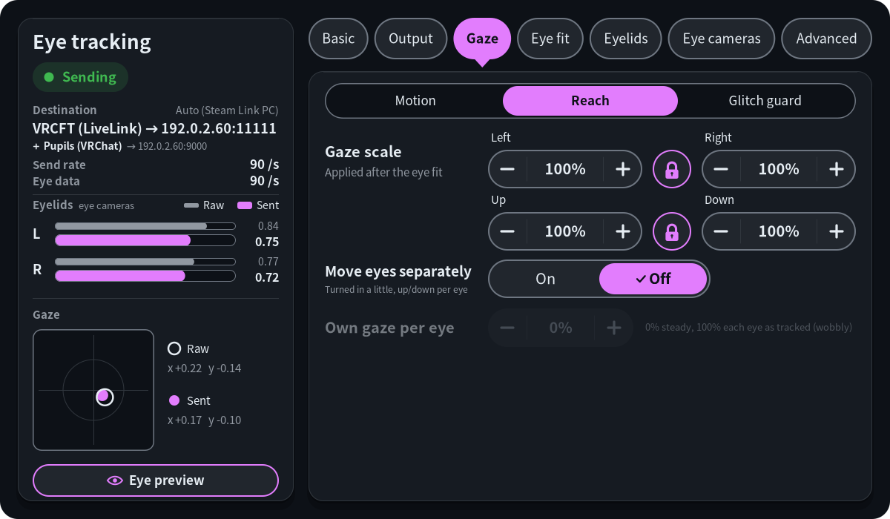
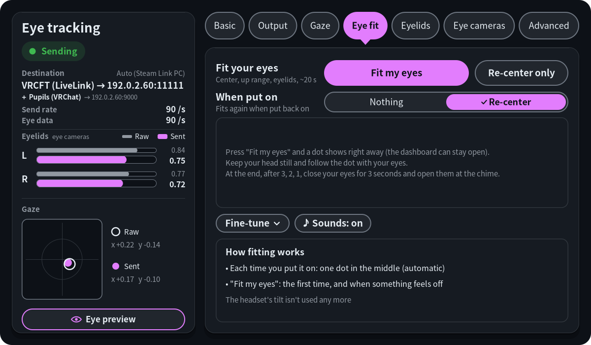
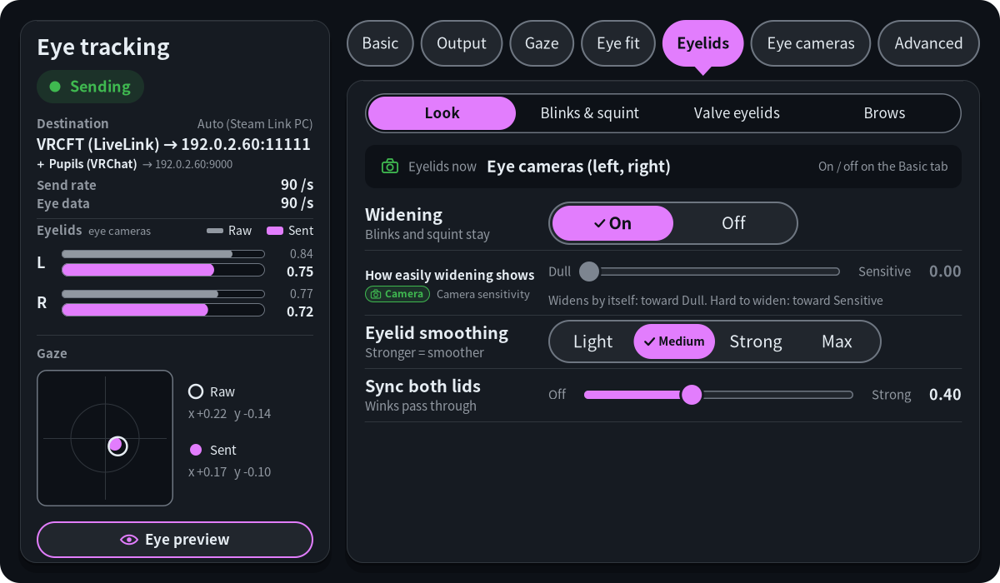
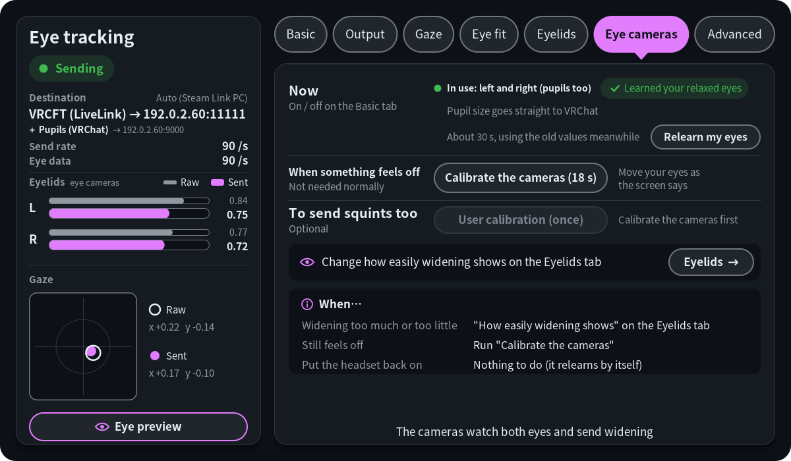
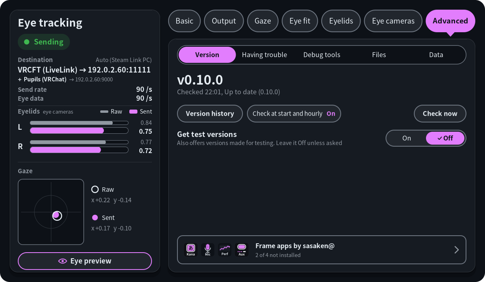
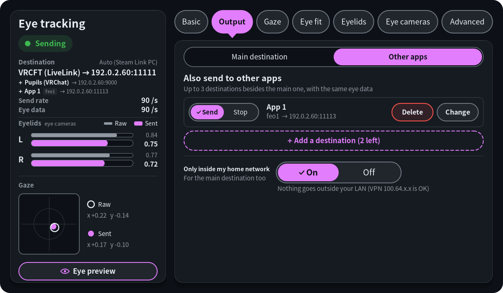

# Panel

[Back to the README](../README.md)

`./install.sh --with-panel` adds an "Eye" panel to the SteamVR dashboard. It starts together with SteamVR from the next SteamVR start; to open it right away, pick "frameeyeosc panel" under Launch program (+) on the dashboard.

| Basic | Output |
|---|---|
|  |  |
| **Gaze** | **Eye fit** |
|  |  |
| **Eyelids** | **Eye cameras** |
|  |  |
| **Advanced** | **Output (Other apps)** |
|  |  |

- The left column always shows what frameeyeosc is doing: sending or paused, where it sends to, messages per second, how many samples a second the eye tracker delivers (marked "low" below 60, with a line under it saying whether frameeyeosc or the Frame was the slow one), both eyelids and the gaze (raw and sent), and a config error if there is one. While the "Track Dominant Eye Only" setting is on, the gaze title line says which eye the Frame tracks ("Frame setting: tracking the right eye only").
- Eye preview: the button at the bottom of the left column opens a sheet over the tabs that draws both eyes as they move: the eyelid (0.75 is relaxed open; widening raises the lid), the squint (the lower lid rises), the pupil's size and where the eye looks, from the values as sent, as read ("Raw": Valve's openness and the gaze before smoothing) or as the eye cameras read them ("Camera"). Under each eye: its eyelid, where it came from ("Valve" or "Camera") and its pupil in mm. "Mirror" (on at first) shows the eyes as in a mirror, your right eye on the right (off: as someone facing you, or your avatar from the front, sees them, your right eye on the left); "Freeze" stops the drawing. With the eye cameras in use, "Camera picture" (off at first, so your eyes never show by accident; once you turn it on, it stays on each time the preview opens until the panel restarts, you turn it off, or the cameras stop) also shows each eye's live camera picture with the pupil eyecam found (green circle), where it looks for it (yellow frame), the upper and lower eyelids it found (a blue and a pink dot above and below the pupil; none on a frame where it found none; as read with "Raw", smoothed so they don't flicker otherwise), the eyelid value the camera read on that frame and "Read as closed"; the switches between the two pictures ("Eyelids", "Pupil", "Search area", all on at first) hide or show those marks. The picture is only shown, never saved (see [Privacy](privacy.md#privacy)). Avatars' eyes differ, so the drawing is for checking the movement. Any tab, the cross or closing the dashboard closes it.
- Basic: pause sending, where to send (three cards: VRChat directly, VRCFT (LiveLink), marked recommended, and VRCFT (FrameEyeOSC), marked all-in-one, each saying how others see your eyes (FrameEyeOSC: pupils and squint too) and what is needed on the PC. While VRChat directly is the output, a grey line under them says that if your avatar's eyes don't move, VRCFT (LiveLink or FrameEyeOSC) makes them move), the eye cameras (before their setup "Not in use" and "Get started →" to the Eye cameras tab; after it "Use / Don't use" (`camera_lids`) and how they are doing, such as "L + R OK"), language (Japanese / English) with "Reset all" at its right, start with SteamVR with "Quit app" at its right.
- Output: two pages under a switch at the top, "Main destination" and "Other apps" (the one open last comes back). Main destination: the target PC (automatic, fixed to the PC it sends to now, or typed: see below) and port (− / ＋, or press the number to type it on a keypad, 1 to 65535). For VRChat directly also the parameter prefix, the EyeTrackingActive type, whether to send Steam Link's parameter names too and whether to move VRChat's own eyes too; for LiveLink and FrameEyeOSC what to set up in VRCFaceTracking on the PC instead (for FrameEyeOSC four steps, with the address of the module's download page; pressing it opens the page in the Frame's browser). With LiveLink and the eye cameras, also "Send pupils straight to VRChat" (`pupils_to_vrchat`); with the eye cameras, for VRChat directly and LiveLink, "How the avatar takes pupils" (`pupil_bits`). Rows like these, which work only with the eye cameras, carry a green "Camera" badge; while the cameras aren't in use (not set up, or "Don't use"), one dashed line that opens the Eye cameras tab takes their place. Other apps: up to 3 more destinations for the same eye data (`extra_outputs`), a row each with Send / Stop, its name, format (`feo1`, the same as FrameEyeOSC, or `osc`), address, a VPN / PUBLIC tag, why it sends nothing (in red), "Delete" and "Change". "Delete" turns the row into its question, "Delete "App 1"? It stops sending there.", with "Cancel" and a red "Delete" (asked in the panel, one row at a time; any other button or tab cancels it). "Add a destination" goes through three steps: the format, the address (same PC as main, the Steam Link PC, this Frame, or an IP typed) and the port (typed the same way); "Change" can also delete one (confirmed in the panel). Names are "App 1" and so on (rename them in `config.json`). Under them, "Only inside my home network" (`lan_only`, on at first, for the main destination too; off, addresses outside the LAN are allowed and marked PUBLIC). Each destination in use gets a line in the left column under the main one (red with why while it is refused).
- Gaze: three pages under a switch at the top (the first time "Motion", then the one you opened last, also after the panel restarts). "Motion": smoothing on or off, light / medium / strong presets and the three filter values, deadzone. "Reach": the gaze scale (how far the eyes go left, right, up and down, 5-200 %, applied after the eye fit, which never changes it; while the lock between left and right, or between up and down, is closed, both change together) and moving the eyes separately. "Glitch guard": holding the gaze while blinking, skipping unreliable gaze, removing one-sample glitches.
- Eye fit: one button that fits straight ahead, the up range and the eyelids in about 20 seconds (see [Eye fit](eye-fit.md#eye-fit)), "Re-center only" (the one dot in the middle), what to fit by itself when you put the headset on ("When put on": nothing or re-center), the result with "Reset", and the values by hand under "Fine-tune" (while it is folded, a box says how fitting works).
- Eyelids: four pages under a switch at the top (the first time "Look", then the one you opened last, also after the panel restarts). "Look": where the eyelids come from now (the eye cameras, one eye camera and Valve's values, or Valve's values; the cameras are switched on the Basic tab), "Widening" On / Off (`widen`; Off: no eyelid goes above relaxed open, with the eye cameras or without, while blinks and squint stay; the slider below is greyed meanwhile), "How easily widening shows" while the eye cameras are in use (one slider from Dull to Sensitive: for eyes on the cameras it sets their widening sensitivity; for an eye on Valve's values it picks Off / Less / Normal / More (`lid_widen`) for eyes with an eye fit), "Half-shut check (AI)" On / Off while the eye cameras are in use (eyecam's eyelid veto, off by default: a small AI double-checks an open eye read as half shut, for example looking to the side, and keeps it open; it may also open up a light squint; experimental, trained on the developer's eyes only), eyelid smoothing (light / medium / strong / max), and how strongly both lids are synced (`lid_sync`). "Blinks & squint": making blinks visible (hold time), blinking both eyes together (`blink_sync_below`), "Sent eyelids" (each eye's eyelid as sent now, green where it is the eye cameras', with "Treat nearly open as open" drawn on it and its two values below: `lid_open_snap` for the eyes without the cameras' eyelid and `camera_lid_open_snap` for those with it), and, while the eye cameras are in use, the lowest eyelid when narrowed (`camera_lid_floor`; it takes effect while an eye is on the cameras). "Valve eyelids": the auto calibration and its learned values, per-eye scales, the closed and open marks drawn over each eye's live openness (blink and open your eyes to set them), and the two smoothing values; while the eye cameras supply both eyes, all of it only stands by for when they lose an eye and says so. "Brows": "Widen raises brows" On / Off (`brow_from_widen`, off at first; the cameras don't see brows, so the avatar's brows follow the widening, also with "Widening" Off) and, while it is on, "Brow raise strength" (`brow_strength`, Weak to Strong).
- Eye cameras: shown while eyecam runs. Before the setup has begun, what the cameras add and "Get started (about 2 min)", which opens the setup checklist (see [Eye cameras](eyecam.md#eye-cameras)); once set up, what drives the eyelids now (switched on or off on the Basic tab) with "Relearn my eyes" under it (learns your relaxed eyes again in about 30 s, keeping the calibration; the eyelids, widening and squint keep working from the old values meanwhile, then move over to the new ones), "Calibrate the cameras (18 s)" for when something feels off, the optional "User calibration (once)" for squints, "How the video is taken" (where eyecam takes the video from, the choice of auto / dsp / the tool, and the tool's install or removal in Konsole; see [Eye cameras](eyecam.md#eye-cameras)), and what to do when (as far as it fits).
- Advanced: five pages under a switch at the top, "Version", "Having trouble", "Debug tools", "Files" and "Data" (the first time "Version", then the one you opened last, also after the panel restarts). "Version": the version with checking for and installing updates (and the automatic check on or off) and "Version history" (each version's summary and changes, newest first; one opens at a time, and the thumbstick or the up / down chevrons on the right scroll). "Having trouble": the Diagnostics page to send as a screenshot when stuck (see [Troubleshooting](troubleshooting.md#troubleshooting)), "Eye camera speed" with a SteamVR that has that setting (SteamOS 0.5.7's: "Always 90 a second" or "Let SteamVR decide"), and the recent records of calibrations and eye fits (see below). "Debug tools": showing gaze dots and their distance, recording the eye log (see below), and while eyecam runs the "Developer" eye-camera recording for tuning the eye processing, which keeps the eye video in `~/eyecam/rec_…/` (about 2.5 GB each time; see [panel/README.md](../panel/README.md)), and, once the eye cameras are set up, "Record for squint training": an optional one-press recording of your eyes for the developer (about 1.5 minutes: closing, squinting, widening and looking around, about 2.7 GB each), to train the "Half-shut check (AI)" on more people's eyes. It asks for your consent and whether you wear glasses or prescription inserts the first time, keeps the recordings in `~/eyecam/contrib/` until you send them privately (a share link from Google Drive or similar) and delete them, and can pack them into one file. "Files": file locations, frameeyeosc's PID, options locked by the command line. "Data": how many eye logs, eye recordings and calibration eye images (developer mode only) this Frame keeps and their size, each with a Delete (asked first, can't be undone; the calibration results stay, so widening stays as tuned).
- Records: every eye-camera calibration started from the panel and every eye fit (also the re-center run by itself when the headset is put on) leaves a small folder in `~/.local/state/frameeyeosc/reports/` (the newest 10 are kept): `summary.json` (what ran, how it ended and why, the versions, the diagnostic code, the conditions: dashboard open or closed, camera and eye-tracker rates, how long since the headset was put on), `status.jsonl` (frameeyeosc's and eyecam's status once a second while it ran), `logs.txt` (frameeyeosc's, the panel's and eyecam's journal and Valve's eye-tracker log from 15 seconds before it to its end, in time order, at most 300 KB), for calibrations `calib_result.json` (its numbers, never eye images) and `report.txt`. "Having trouble" lists the newest three ("All records" lists them all); "View" opens one: the reason, what happened in order, and the files. A failed fit or calibration says its log was saved, with "View record". Over SSH, `.local/bin/frameeyeosc-panel --report latest` prints the newest record's `report.txt` (`--report list` lists them, `--report <folder>` prints one); it works without SteamVR. Nothing is sent anywhere.

The panel writes `config.json` and reads the status file. To pick its default language, it also reads the `language` line of Steam's `~/.steam/registry.vdf` once at startup (read only). For updates it runs `~/.local/share/frameeyeosc/frame-update.sh` (see above). Closing it, quitting it, or not installing it doesn't stop frameeyeosc. While it isn't open on the dashboard it draws nothing. Besides running the update check, the only thing it reads then is the update state file (`~/.cache/frameeyeosc/update-state.json`), about twice a second. The exceptions are an eye fit (it then also reads the status file and shows the dot, with the dashboard open or closed, until the fit is over) and the debug gaze dots while they're switched on (it then listens on their socket and moves the dots about 90 times a second while samples arrive, and reads the status file and checks `config.json` for changes 10 times a second), and "When put on" while the gaze is fitted (it then reads the status file every 0.5 s while the dashboard is closed, to notice the headset being put on). While the eye preview is open it listens on the gaze dots' socket (without showing the dots) and redraws about 30 times a second; with its camera picture on, it asks eyecam for the pictures every second and reads them. Its "Start with SteamVR" switch enables or disables its systemd user unit (`frameeyeosc-panel.service`). Build notes and debugging options are in [panel/README.md](../panel/README.md) (Japanese).

## Setting the target PC by hand

"Auto" sends to the PC Steam Link is streaming from. If that is the wrong PC, press "Enter IP" in the Target PC row on the Output tab. A keypad opens: type the PC's IPv4 address (for example `192.168.1.20`) and press "OK". Leave the port out; it goes in the Port row. The panel writes it to `host` in `config.json`, and the row shows "Manual 192.168.1.20". "Auto" switches back. To use a host name instead of an address, set `host` in `config.json` by hand; the row then shows "Manual" and the name, and "Auto" still switches back.

## Starting the eye fit from another app

Other apps on the Frame (a button on the controller, say) can press the panel's eye fit buttons, and "Relearn my eyes", with a command. The panel has to be running; the command never starts it:

```sh
~/.local/bin/frameeyeosc-panel --action recenter   # "Re-center only" (the middle dot, about 2.5 s)
~/.local/bin/frameeyeosc-panel --action fit        # "Fit my eyes" / "Fit again" (about 20 s)
~/.local/bin/frameeyeosc-panel --action stop       # "Stop" for the fit or re-center running
~/.local/bin/frameeyeosc-panel --action relearn    # "Relearn my eyes" on the Eye cameras tab (about 30 s)
~/.local/bin/frameeyeosc-panel --action open       # open the panel (as launching it a second time does)
```

Each works like pressing the button (and only when the button could be pressed), with the dashboard closed too: the dots show as for the automatic re-center when the headset is put on, and the dashboard stays closed (opening it then stops the fit, as always). With the dashboard open, the panel switches to its Eye fit tab, where "Stop" is. The command prints one short line to stderr (for example `recenter: started` or `fit: busy (a fit is running; use --action stop)`) and exits with:

| Code | Meaning |
|---|---|
| 0 | Done: the re-center, fit or relearning started, `stop` stopped one, `open` showed the panel |
| 1 | Unknown action, unknown option or bad arguments (every usage error of `frameeyeosc-panel` exits 1; an unknown action is refused without contacting the panel) |
| 2 | The panel isn't running (or is 0.7.9 or earlier, without this command) |
| 3 | No answer from the panel within 2 seconds |
| 4 | frameeyeosc isn't running |
| 5 | `recenter` before any gaze fit: run `fit` first |
| 6 | Busy: an eye fit is running (`stop` it first) |
| 7 | `stop` with nothing running |
| 8 | The fit's values are locked by frameeyeosc's command line (the buttons are grey too) |
| 9 | frameeyeosc runs but no eye data comes in (most often the headset isn't on) |
| 10 | Busy: a re-center is running (also the automatic one after putting the headset on; `stop` it first) |
| 11 | `relearn`: the eye cameras aren't in use or ready (off, not set up, eyecam not running or busy, no eye video), or eyecam said no. Also `recenter`, `fit` and `relearn` while the eye cameras are calibrating (the line then says `calibrating`; the fit buttons are grey meanwhile) |

The panel answers within about a quarter of a second (one pass of its loop with the dashboard closed); `relearn` waits for eyecam's answer too, at most a second more. It talks to the running panel over a socket only you can use (`$XDG_RUNTIME_DIR/frameeyeosc-panel.sock`, details in [panel/README.md](../panel/README.md#ほかのアプリから動かす--action)). The panel only looks at that socket while it waits; a request makes it read the status file and `config.json` once. `--version` tells which panel is installed.
